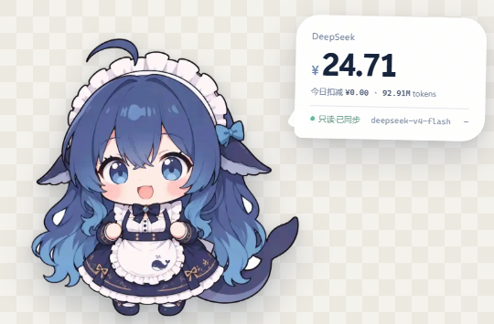

# WhaleMeter · 大肥鱼

[简体中文](README.md) | [English](README.en.md)

一个本地优先的大模型余额、费用和 token 监控器。桌面挂件只保留图库中的蓝色鲸鱼，余额与扣费以小气泡的形式贴近鲸鱼显示；完整数据面板仍参考 Token Monitor 的信息层级。

## 下载

Windows 安装包请前往 [Releases](https://github.com/Potatoyang22/-token-/releases)。

## 挂件模式



- 启动后默认只显示透明背景上的蓝色鲸鱼，完整面板藏在后台
- 不再使用整块蓝色卡片，仅保留鲸鱼、白色余额气泡和扣费泡泡
- 挂件使用最高置顶层，显示在 Codex 等前台窗口之上
- 挂件可拖动、无任务栏图标，不会抢输入焦点
- 默认只读监听 Codex 本地会话日志，真实调用发生后挂件自动出现
- 本地代理收到 OpenAI-compatible 请求时同样会自动出现并同步
- 本地监听不会调用模型，不产生额外 token 消耗
- 每笔真实用量会产生一个“鲸鱼吐泡泡”气泡；已知价格时显示估算扣费，未知价格时显示本次 token
- 余额刷新发现真实扣减时，会额外吐出一个“余额扣减”气泡
- 本次扣费会立即从上次同步余额中扣除，服务商余额同步后自动校准
- 连续请求会合并 UI 更新，最多保留 4 个扣费气泡，避免动画堆积
- 点击挂件右上角箭头打开完整面板，关闭挂件后会在下次请求时自动出现
- 可以在设置中关闭“使用模型时自动弹出挂件”

## 数据来源

- Codex 本地只读监听：读取 `~/.codex/sessions/**/*.jsonl` 中的 `token_usage_record`
- 本地代理：读取 OpenAI-compatible 请求响应中的 `usage`
- 余额接口：只查询余额，不调用模型
- 如果本地没有单独保存 API Key，会只读复用 `~/.codex/auth.json` 中的 `OPENAI_API_KEY` 查询 DeepSeek 余额，不复制、不写入挂件配置
- 今日扣费以当天第一次成功同步的余额为基线，用后续真实余额下降计算
- 挂件不再使用演示金额；未配置余额接口时显示 `—`
- 当前模型价格未知时显示“费用未知”，不会伪造金额

## 当前能力

- DeepSeek 余额查询：`GET /user/balance`
- OpenRouter Credits 查询：`GET /api/v1/credits`
- 自定义 JSON 余额接口与字段路径
- 本地 OpenAI-compatible 代理：`http://127.0.0.1:8787/v1`
- 从响应或 SSE 中读取 `usage`
- 当上游没有返回 usage 时，按字符数估算 token，并在界面标记 `est.`
- 显示今日消费、输入/输出 token、缓存命中、平均延迟、模型分布与实时请求流
- API Key 使用 Electron `safeStorage` 调用 Windows 系统安全存储加密
- 托盘入口、余额定时刷新和鲸鱼品牌图标

## 运行

```powershell
git clone https://github.com/Potatoyang22/-token-.git
cd ./-token-
npm install
npm start
```

第一次启动会直接读取 Codex 本地用量；余额会自动复用本地 Codex 的 DeepSeek Key。需要更换服务商时，可从挂件打开完整面板并配置账户。

## 接入请求统计

在支持自定义 Base URL 的 OpenAI 兼容客户端中，将地址改为：

```text
http://127.0.0.1:8787/v1
```

例如：

```python
from openai import OpenAI

client = OpenAI(
    base_url="http://127.0.0.1:8787/v1",
    api_key="任意占位值",  # WhaleMeter 会用设置中的真实 Key 覆盖
)

response = client.chat.completions.create(
    model="deepseek-chat",
    messages=[{"role": "user", "content": "你好"}],
)
```

代理只会监听 `127.0.0.1`，请求会转发到设置中的“上游 Base URL”。WhaleMeter 不保存 prompt 或响应正文，只保存请求用量元数据。

## 数据与安全

- 配置文件、事件记录位于 Electron 的 `userData` 目录
- API Key 通过操作系统安全存储加密
- 余额来自各服务商接口，实际账单金额以服务商为准
- 费用是 token × 本地价格表的估算值，不一定等于最终扣费
- 自定义余额接口需要返回 JSON，字段路径例如 `data.balance`

## 开发检查

```powershell
npm run check
npm run capture
```

截图会写入 `screenshots/` 目录。

## 安全

请阅读 [SECURITY.md](SECURITY.md)。请不要通过公开 Issue 报告安全漏洞，也不要附带 API Key、Cookie 或未经脱敏的会话日志。

## 设计与许可

UI 设计语言参考 Token Monitor（MIT）。本项目代码使用 MIT License；用户提供的鲸鱼照片仅作为本项目的品牌素材使用。
